# findmy_parser — step-by-step guide

How to run the tool against an iOS extraction or a Cellebrite Physical
Analyzer export, and how to read what comes out.

> **About the screenshots in this guide.** Every screenshot was taken
> from a synthetic demo export, not from real case data. No device,
> account, serial number, coordinate, pairing date or name belonging to
> any real examination appears anywhere in this document. The demo
> export is built by [`make_demo_export.py`](make_demo_export.py) in
> this folder, so you can rebuild it and reproduce every screenshot
> yourself:
>
> ```sh
> python docs/make_demo_export.py demo_export
> findmy-parser demo_export
> ```
>
> Nothing needed redacting because nothing real was ever used.

---

## Contents

1. [Before you start](#1-before-you-start)
2. [Install](#2-install)
3. [What to point it at](#3-what-to-point-it-at)
4. [Check the data first](#4-check-the-data-first-optional-but-recommended)
5. [Run it](#5-run-it)
6. [What you get](#6-what-you-get)
7. [Reading the HTML report](#7-reading-the-html-report)
8. [What the report flags for you](#8-what-the-report-flags-for-you)
9. [Mapping the tracks (KML)](#9-mapping-the-tracks-kml)
10. [Troubleshooting](#10-troubleshooting)
11. [Notes for your report](#11-notes-for-your-report)

---

## 1. Before you start

**What you need**

- Python 3.10 or later.
- An iOS full filesystem extraction, or a Physical Analyzer export of
  the two Find My cache folders (see [section 3](#3-what-to-point-it-at)).
- Nothing else. The tool has no third-party dependencies and makes no
  network connections, so it runs on an offline forensic workstation.

**What it does to your evidence: nothing.** The tool only ever opens
files for reading. It never writes to, renames, moves or modifies
anything inside the path you give it; all output goes to a separate
folder of your choosing. Work from a copy anyway, as you normally would.

**What it reads**

| Source | What it gives you |
| --- | --- |
| `com.apple.icloud.searchpartyd/BeaconEstimatedLocation/<UUID>/*.record` | The location history — many timestamped fixes per tracker |
| `com.apple.icloud.searchpartyd/OwnedBeacons/`, `SharedBeacons/` | Pairing date, battery level, ownership |
| `com.apple.icloud.searchpartyd/BeaconNamingRecord/` | Friendly name and emoji |
| `com.apple.findmy.fmipcore/Items.data` | AirTags and accessories: name, emoji, serial, model |
| `com.apple.findmy.fmipcore/Devices.data` | Apple devices on the same iCloud account |

---

## 2. Install

On a machine with internet access:

```sh
pip install -e .
```

**Installing offline** (the usual case on a forensic workstation):
download the repository as a ZIP, copy it across, extract it, then from
inside the extracted folder run the same command. There are no
dependencies to fetch, so this works with no network.

```sh
cd findmy_parser-main
pip install -e .
```

That gives you two commands: `findmy-parser` and
`findmy-parser-diagnose`.

If you would rather not install anything at all, every command in this
guide also works as a module from inside the extracted folder — replace
`findmy-parser` with `python -m findmy_parser.cli`, and
`findmy-parser-diagnose` with `python -m findmy_parser.diagnose`.

---

## 3. What to point it at

Give the tool **one path**. That can be:

- a full filesystem extraction root (it will find the caches itself),
- a Physical Analyzer export folder, or
- a single `.record` or `.data` file.

You do **not** need to find the right subfolder, and you do not need the
folders to be at any particular depth. The tool scans the whole path
recursively and works out what each file is from its content and its
position, not from a fixed layout.

A typical Physical Analyzer export looks like this:

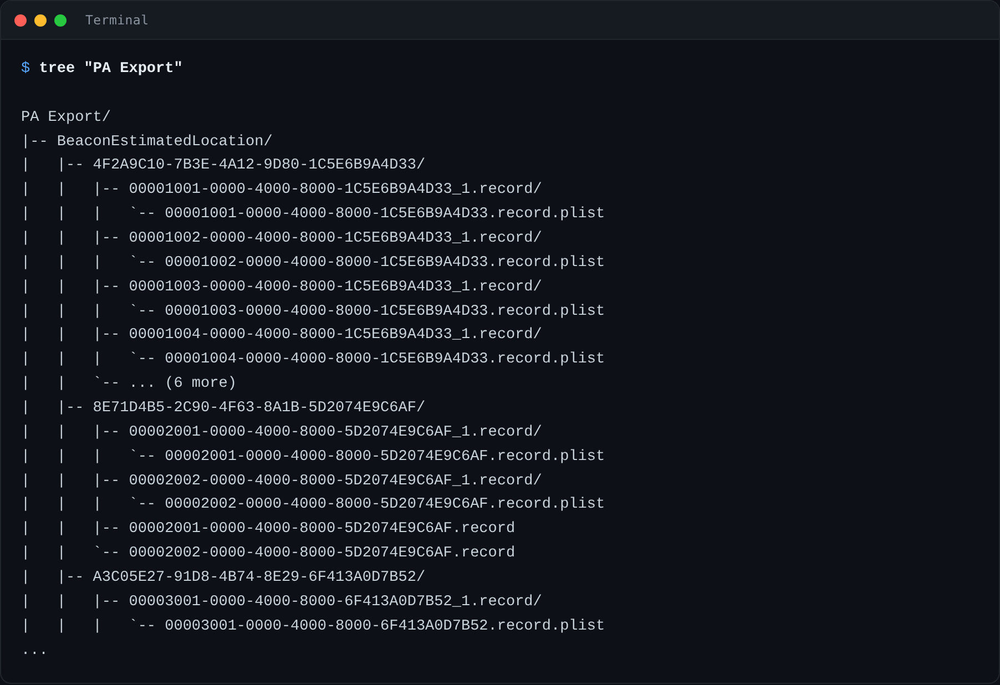

Two things in that listing are worth understanding, because they explain
numbers you will see later:

- **Each record appears twice.** `<uuid>.record` is the signed,
  encrypted copy as it sat on the device; the real contents are in the
  sibling `<uuid>_1.record/<uuid>.record.plist` that Physical Analyzer
  decrypted. The tool reads the decrypted copy and counts the encrypted
  one as skipped — that is why "files found" is roughly double "files
  parsed", and it is normal.
- **The UUID folder is not always the record's parent.** PA inserts an
  extra `_1.record` folder in between. The tool walks back up the path
  to the nearest UUID-shaped folder rather than assuming the parent, so
  the extra nesting does not break the association.

If your path contains spaces, quote it:

```sh
findmy-parser "D:\Case_2026-0917\PA Export"
```

---

## 4. Check the data first (optional, but recommended)

Before a full run, this tells you what the files actually are and
whether the tracker names will be able to join to the location history:

```sh
findmy-parser-diagnose "PA Export"
```

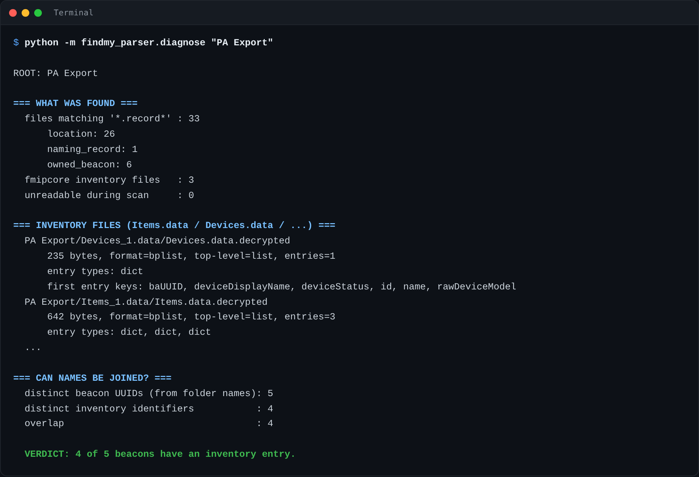

Read it from the bottom up:

- **`VERDICT: 4 of 5 beacons have an inventory entry`** — how many
  trackers will come out with a friendly name. If this said *0 of 5*,
  the inventory files use a different identifier from the beacon
  folders, and you would expect the names to be blank.
- **`signed/encrypted on-device form`** — this file is still encrypted
  and cannot be read. If *every* file is flagged this way, the export
  was not decrypted; go back to Physical Analyzer.
- **The key lists** tell you which fields each file actually carries, so
  you can see for yourself that, say, `pairingDate` is present.

This command deliberately prints field *names*, types and counts but
never field *values*, and it withholds full identifiers unless you pass
`--show-ids`. That makes its output safe to share when asking for help.

---

## 5. Run it

```sh
findmy-parser "PA Export"
```

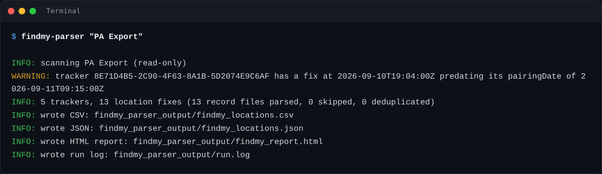

The run prints a one-line summary and any warnings. Warnings are
information, not failures — a file it cannot read is logged, skipped,
and the run carries on. A single corrupt record never stops the job.

Useful options:

| Option | Effect |
| --- | --- |
| `--output-dir DIR` | Where to write everything (default `./findmy_parser_output`) |
| `--kml PATH` | Also write a KML track file (off unless you ask) |
| `--no-html`, `--no-csv`, `--no-json` | Skip an output format |
| `-v` | Verbose logging, for when something looks wrong |

---

## 6. What you get

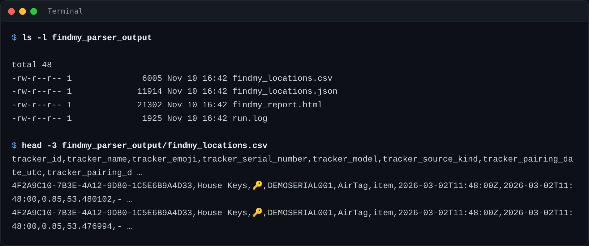

| File | What it is for |
| --- | --- |
| `findmy_report.html` | **Start here.** The readable report — one card per tracker |
| `findmy_locations.csv` | One row per location fix, for Excel or your analysis tool |
| `findmy_locations.json` | The same data structured, for scripting |
| `run.log` | What was found, parsed, skipped and why — your audit trail |
| `findmy_tracks.kml` | Only written if you passed `--kml` |

The CSV carries 18 columns. Alongside the obvious ones, note:

- `timestamp_utc` **and** `timestamp_raw` — the normalised UTC value and
  the original stored value, side by side, so the conversion is always
  checkable.
- `tracker_source_kind` — whether the tracker's details came from
  `Items.data`, `Devices.data` or a searchpartyd record.
- `content_hash` — the deduplication key.
- `source_file` — the exact file each row came from.

---

## 7. Reading the HTML report

Open `findmy_report.html` in any browser. It is a single self-contained
file with no external requests, so it works offline and can be attached
to a report or exhibited as-is.

The top gives you the run at a glance, then the trackers begin:

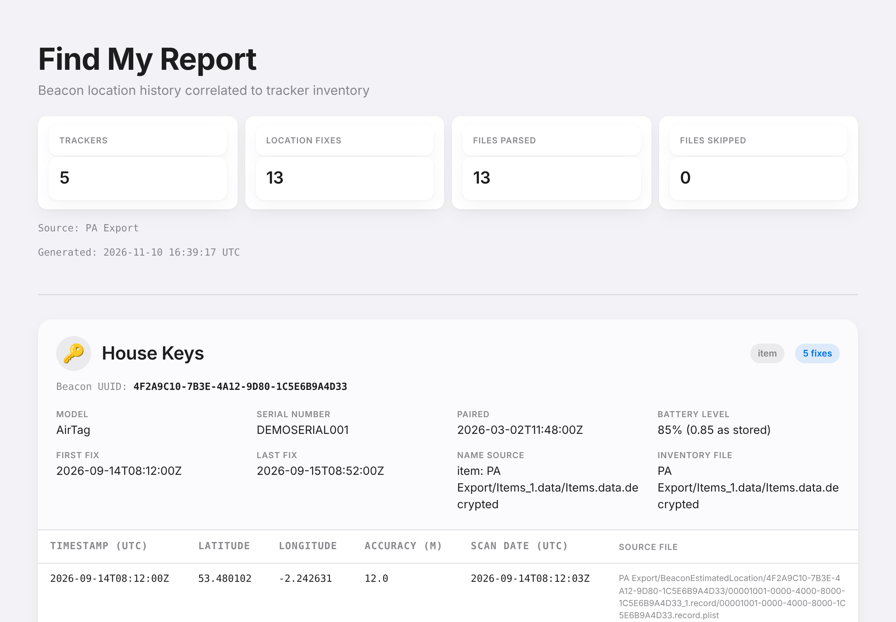

Each tracker gets one card. The header carries the identity, the
**Beacon UUID spelled out** so the association can be verified against
the source folders, and the details drawn from the inventory — then its
full location history in chronological order beneath:

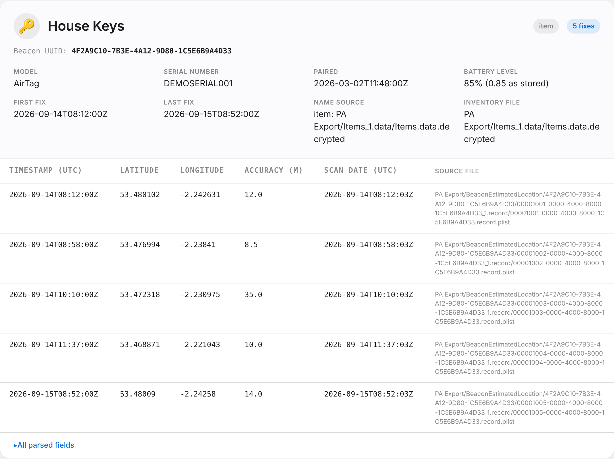

Every row names the file it came from, so any individual fix can be
traced back to a single `.record` on disk.

At the foot of each card, **All parsed fields** expands to show every
other field found for that tracker, including ones the tool does not
map to a column of its own:

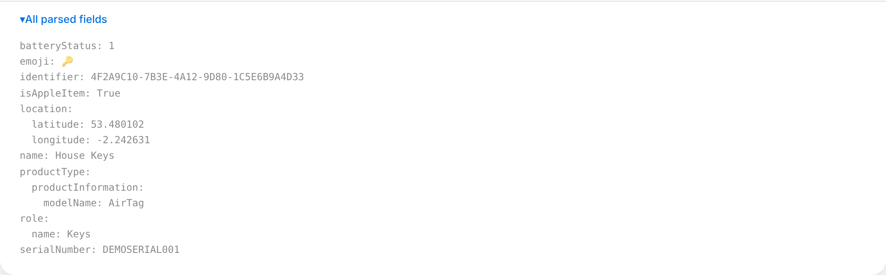

The report follows your system appearance, so it is legible in dark mode
too:

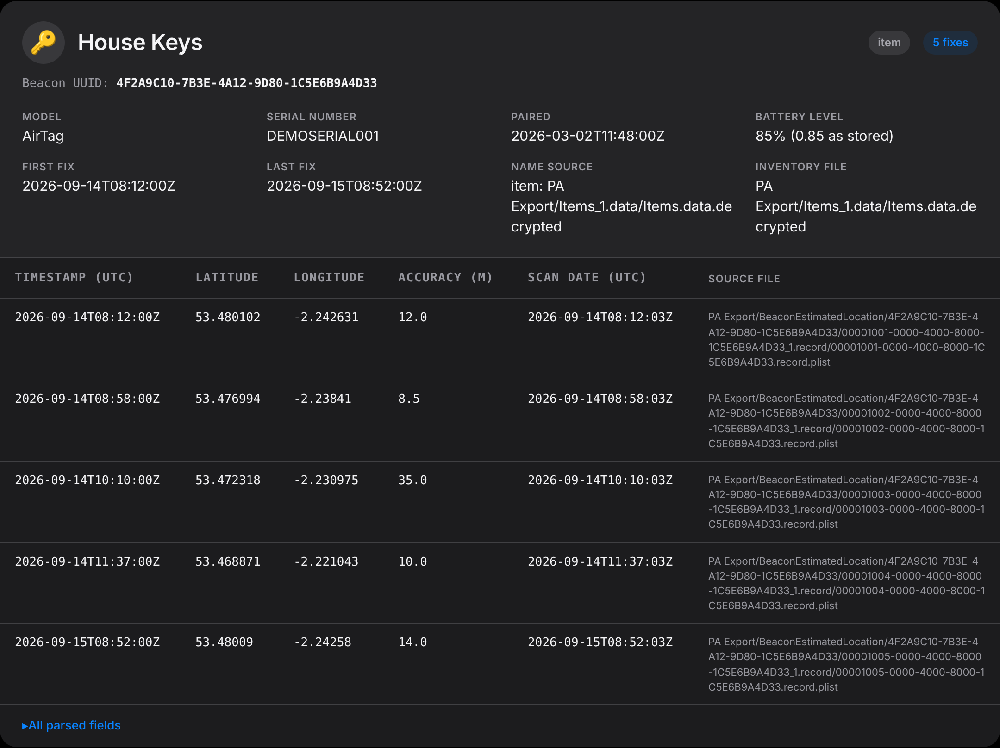

---

## 8. What the report flags for you

### A location fix that predates the pairing date

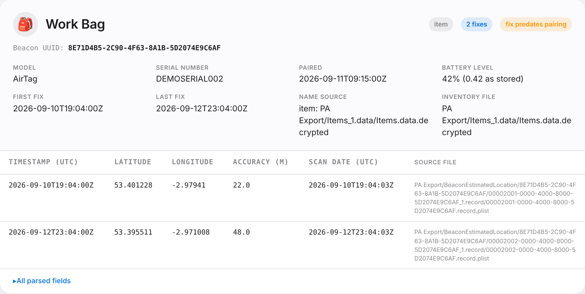

The amber **fix predates pairing** pill means this tracker has a
recorded location from *before* the `pairingDate` in its ownership
record. The tool reports the discrepancy and deliberately does not
interpret it. It can indicate a previous pairing to another account, a
`pairingDate` reset by re-pairing, clock skew, or simply that
`pairingDate` does not mean what it appears to. Treat it as something to
look into, not as a finding in itself.

### A tracker with no name

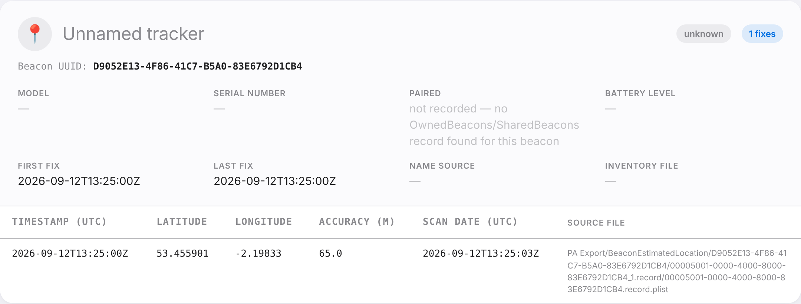

Location data is **never dropped** for want of a label. A beacon with
history but no inventory entry still gets a full card, marked
*unknown*, with its UUID and all of its fixes. Blank fields read as
`—`, and where the tool knows *why* something is missing it says so
rather than leaving a blank — here, that no ownership record was found
for this beacon at all.

### The run log

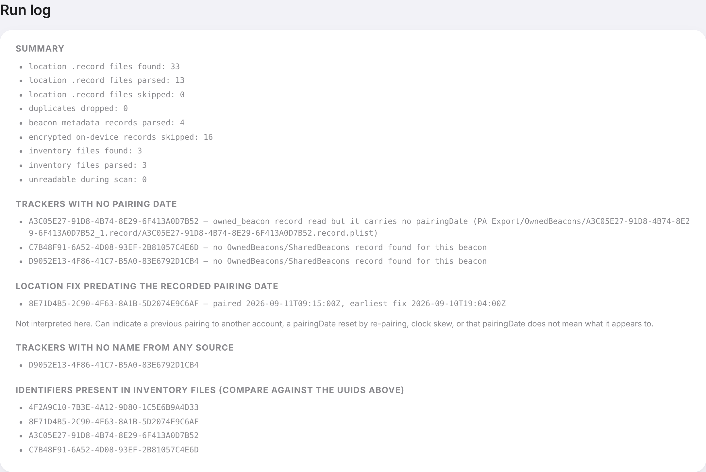

The same content as `run.log`, at the foot of the report. This is where
you check the work:

- **Summary counts** — found vs parsed vs skipped vs deduplicated.
  "Encrypted on-device records skipped" being roughly half of "found" is
  the normal PA double-export pattern described in
  [section 3](#3-what-to-point-it-at).
- **Trackers with no pairing date** — and, importantly, *why*: an
  ownership record that was read but carries no `pairingDate` field is a
  different fact from no ownership record existing at all. The two are
  distinguished rather than both rendering as blank.
- **Trackers with no name from any source**, followed by **identifiers
  present in inventory files** — put side by side on purpose. If those
  two lists contain entirely different UUIDs, the inventory simply does
  not use the same identifier as the beacon folders, and that is
  diagnosable from the report alone.

---

## 9. Mapping the tracks (KML)

```sh
findmy-parser "PA Export" --kml tracks.kml
```

Writes one track per tracker UUID, points in chronological order, which
you can open in Google Earth or any GIS tool. Fixes with no usable
timestamp sort last rather than being silently discarded.

---

## 10. Troubleshooting

| What you see | What it means | What to do |
| --- | --- | --- |
| `input path does not exist` | Usually an unquoted path containing spaces | Wrap the path in quotes |
| Every record reported as encrypted | The export was never decrypted | Re-export from Physical Analyzer with decryption |
| `inventory files found: 0` | `Items.data` / `Devices.data` were not in the scanned path | Check they were included in the export; `.decrypted` suffixes are handled automatically |
| Tracker names all blank | The inventory uses different identifiers from the beacon folders | Run `findmy-parser-diagnose` and read the `CAN NAMES BE JOINED?` verdict |
| A handful of files skipped | Corrupt, truncated or an unexpected format | Check `run.log` — each skip is listed with its reason and path |
| `record files found` is about double `parsed` | Normal: PA exports each record twice | Nothing — confirm the encrypted-skipped count accounts for the difference |

---

## 11. Notes for your report

Points worth stating explicitly when this tool's output is relied on:

- **Timestamps.** Apple mixes native plist date values, Cocoa-epoch
  numbers (from 2001-01-01) and Unix-epoch numbers, in seconds or
  milliseconds. The tool detects the format by magnitude and normalises
  everything to ISO 8601 UTC, and preserves the raw stored value next to
  it in the CSV and JSON so every conversion can be independently
  checked.
- **Deduplication.** PA exports the same record into more than one
  nested folder. Duplicates are identified by a content hash of the
  parsed fields and dropped, with each drop logged in `run.log` naming
  both the duplicate and the copy that was kept. The fix count is
  therefore a count of distinct fixes, not of files.
- **Confirmed vs assumed fields.** The schema was confirmed against real
  record data; fields named in other write-ups but not observed
  (`confidence`, `status`) are preserved verbatim if present but never
  interpreted. `Devices.data`'s exact schema is not fully confirmed —
  see the Status section of the [README](../README.md).
- **What `locationSource` means is not established.** It is reported as
  stored. No public source defining its values was found.
- **Scope.** This reads the on-device caches only. It is not an iCloud
  acquisition and does not contact Apple.
